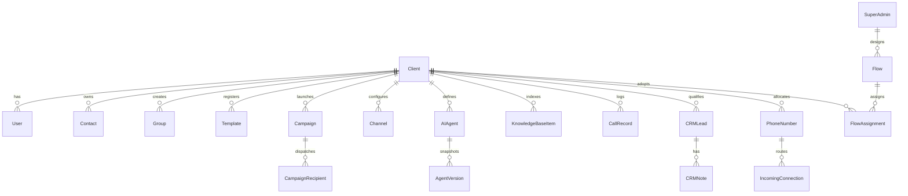

# AutoComm - Software Architecture & Technical Design Document

---

## 1. System Overview & Technology Stack

AutoComm is a production-grade multi-tenant SaaS platform for automated business communications across two unified channels:
1. **WhatsApp Messaging ("Whatway")**: Meta WhatsApp Cloud API integration for template broadcasts, session messaging, interactive buttons, webhooks, and team inbox operations.
2. **Automated AI Voice Calling ("AgentLab")**: Conversational AI voice agents (Incoming and Flow), multi-turn dialogs, speech synthesis/recognition, knowledge base grounding, and real-time call tracking.

```
+---------------------------------------------------------------------------------------+
|                                    AutoComm SaaS                                      |
+---------------------------------------------------------------------------------------+
|  Client Web App (React + Vite)       |       Super Admin Web App (React + Vite)       |
|  - Dashboard, Campaigns, Templates   |       - Client Management, Flow Builder        |
|  - Contacts, Team Inbox, Channels    |       - Global Phone Numbers & Channels        |
|  - AI Agents, Knowledge Base, CRM    |       - Cross-Tenant Monitoring & Reports      |
+--------------------------------------+------------------------------------------------+
                                   | (REST + Socket.IO)
                                   v
+---------------------------------------------------------------------------------------+
|                        API Gateway / Express Server Layer                             |
|  - Security & Rate Limiting (120 req/min, burst 30/s)                                 |
|  - Dual Auth: Client JWT vs Super Admin JWT vs API-Key / Secret (X-API-Key)           |
|  - Tenant Scoping Middleware (Injects clientId, enforces data isolation)              |
|  - Strict Layering: Route -> Controller -> Service -> Repository                     |
+---------------------------------------------------------------------------------------+
                                   |
         +-------------------------+-------------------------+
         |                                                   |
         v                                                   v
+----------------------------------+        +-----------------------------------+
|     Primary Database Storage     |        |      Queue & Cache Subsystem      |
|  MongoDB (Mongoose ODM)          |        |  Redis + BullMQ                   |
|  - Clients, Users, Roles         |        |  - campaign-dispatch (batched)    |
|  - Contacts, Groups, Templates   |        |  - campaign-retry (15m fallback)  |
|  - Campaigns, Recipient Logs     |        |  - call-dispatch                  |
|  - AI Agents, Flows, Knowledge   |        |  - webhook-processor (idempotent) |
|  - Calls, CRM Leads, Audit Logs  |        |  - daily-cleanup (30-day purge)   |
+----------------------------------+        +-----------------------------------+
                                                             |
                                                             v
+---------------------------------------------------------------------------------------+
|                               Background Workers Layer                                |
|  - Dispatcher Worker: Meta WhatsApp Cloud API & Telephony (Twilio / Plivo)            |
|  - AI Agent Realtime Service: OpenAI / ElevenLabs / Gemini                            |
|  - Scheduled Jobs: Cron for scheduled campaigns & 30-day purged campaign cleaner      |
+---------------------------------------------------------------------------------------+
```

### Technology Matrix
- **Backend Runtime:** Node.js (v20+ LTS)
- **API Framework:** Express.js
- **Database:** MongoDB with Mongoose ODM (fully indexed multi-tenant schemas)
- **Queue & Background Jobs:** Redis 7+ and BullMQ
- **Real-Time Layer:** Socket.IO for Team Inbox and live telemetry
- **Security & Cryptography:** JWT (Access + Refresh tokens), bcrypt (password hashing), crypto AES-256-GCM for credential encryption at rest
- **Validation:** Zod / Joi validation schemas
- **Logging & Telemetry:** Winston structured JSON logger with request correlation IDs
- **Email Dispatch:** Nodemailer (SMTP / SendGrid compatible) with reusable HTML templates
- **Frontend Frameworks:** React 18+ (Vite), React Router v6, TailwindCSS matching `omnichannel-saas` design tokens, Lucide Icons, Axios with automatic token refresh, React Hook Form + Zod.

---

## 2. Target Folder Structure

```
autocomm/
  docs/
    AutoComm_Overview_Document_.pdf
    ARCHITECTURE.md
    API.md
    ASSUMPTIONS.md
  backend/
    src/
      config/
        database.js
        redis.js
        logger.js
        env.js
        constants.js
      common/
        errors/
          app-error.js
          error-handler.js
        middlewares/
          auth.middleware.js
          superadmin-auth.middleware.js
          tenant.middleware.js
          rbac.middleware.js
          api-key.middleware.js
          rate-limiter.middleware.js
          validator.middleware.js
        utils/
          crypto.util.js
          jwt.util.js
          csv.util.js
          response.util.js
          pagination.util.js
        enums/
          roles.enum.js
          statuses.enum.js
          channels.enum.js
      modules/
        auth/
        clients/
        users/
        roles-permissions/
        dashboard/
        campaigns/
        templates/
        contacts/
        groups/
        team-inbox/
        channels/
        ai-settings/
        ai-agents/
        knowledge-base/
        voice-library/
        calls/
        quick-crm/
        phone-numbers/
        incoming-connections/
        analytics/
        api-docs/
        email-templates/
        flows/
        audit-logs/
        credits/
      integrations/
        whatsapp-cloud/
        telephony/
          twilio.adapter.js
          plivo.adapter.js
        ai/
          gemini.adapter.js
          openai.adapter.js
          elevenlabs.adapter.js
        email/
          nodemailer.service.js
      queues/
        campaign.queue.js
        call.queue.js
        webhook.queue.js
        cleanup.queue.js
      workers/
        campaign.worker.js
        call.worker.js
        webhook.worker.js
        cleanup.worker.js
      webhooks/
        whatsapp.webhook.js
        telephony.webhook.js
      app.js
      server.js
      worker.js
    tests/
  client-app/
    src/
      config/
      features/
        auth/
        dashboard/
        campaigns/
        templates/
        contacts/
        team-inbox/
        channels/
        ai-settings/
        ai-agents/
        knowledge-base/
        voice-library/
        calls/
        quick-crm/
        phone-numbers/
        analytics/
        api-docs/
      shared/
        components/
          layout/
          ui/
        hooks/
        api/
        types/
      App.jsx
      main.jsx
      index.css
  superadmin-app/
    src/
      features/
        auth/
        dashboard/
        clients/
        email-templates/
        flows/
        monitoring/
        phone-numbers/
        reports/
      shared/
        components/
          layout/
          ui/
        api/
      App.jsx
      main.jsx
      index.css
  docker-compose.yml
  README.md
```

---

## 3. Data Model & Entity Relationship (ER) Design

All tenant entities contain `clientId: { type: ObjectId, ref: 'Client', index: true, required: true }`.

### Core Schemas



#### 1. Client (`clients`)
- `_id`: ObjectId
- `companyName`: String
- `clientCode`: String (unique, e.g. `CLI-1029`)
- `status`: Enum (`active`, `inactive`, `suspended`)
- `plan`: String (`Enterprise Scale`, `Growth`, `Starter`)
- `contactNumber`: String
- `adminEmail`: String
- `assignedPhoneNumbers`: [String]
- `credits`: Number (default 10,000)
- `settings`: Object (rate limits, fallback options)
- `createdAt`, `updatedAt`: Date

#### 2. User (`users`)
- `_id`: ObjectId
- `clientId`: ObjectId (nullable for Super Admin)
- `name`: String
- `email`: String (indexed)
- `passwordHash`: String
- `role`: Enum (`Super Admin`, `Admin`, `System Admin`, `Admin Operator`, `Inbox Agent`)
- `status`: Enum (`active`, `pending`, `inactive`)
- `mustChangePassword`: Boolean (default true for newly provisioned admins)
- `lastLoginAt`: Date
- `createdAt`, `updatedAt`: Date

#### 3. Contact & Group (`contacts`, `groups`, `group_members`)
- **Contact:** `clientId`, `name`, `email`, `phoneNumber` (E.164), `whatsappNumber`, `channels` (`['whatsapp', 'voice']`), `status` (`Active`, `Pending`, `Inactive`), `customVariables` (Map/Object), `lastContactAt`.
- **Group:** `clientId`, `name`, `code`, `category` (e.g. `Customer Segments`), `description`, `status` (`Active`), `contactCount`: Number.
- **GroupMember:** `groupId`, `contactId`, `clientId`, `addedAt`.

#### 4. Template (`templates`)
- `clientId`: ObjectId
- `type`: Enum (`whatsapp`, `voice`)
- `name`: String (lowercase + underscores only)
- `category`: String
- `status`: Enum (`Active`, `In Review`, `Draft`, `Approved`)
- **WhatsApp Specifics:** `headerFormat` (`None`, `Text`, `Image`, `Video`, `Document`), `headerText`, `bodyText` (max 1024), `sampleParameters` ([String]), `footerText` (max 60), `buttons` ([{ type, text, url, phoneNumber }]), `metaTemplateId`, `metaStatus`.
- **Voice Specifics:** `synthesisLanguage`, `firstMessage` (max 300), `prompt`, `voiceTone` (`Professional`, `Empathetic`, `Urgent`, `Friendly`), `personality` (`Financial Advisor`, `Support Specialist`, `Compliance Officer`).

#### 5. Campaign (`campaigns`)
- `clientId`: ObjectId
- `name`: String
- `channelType`: Enum (`whatsapp`, `voice`)
- `campaignType`: String (e.g. `Lead Qualification`, `Marketing`, `Billing`)
- `status`: Enum (`Draft`, `Scheduled`, `Ongoing`, `Completed`, `Paused`, `Failed`)
- `templateId`: ObjectId (ref Template)
- `agentId`: ObjectId (ref AIAgent, for voice)
- `phoneNumberId`: ObjectId (ref PhoneNumber, for voice)
- `audienceType`: Enum (`group`, `contacts`, `csv`)
- `targetGroupIds`: [ObjectId]
- `scheduledAt`: Date
- `enableAutoRetry`: Boolean
- `callSchedulingWindow`: { startTime, endTime, daysOfWeek, timezone }
- `customScript`: String
- `metrics`: { totalRecipients, sent, delivered, read, answered, failed, successful }
- `isDeleted`: Boolean (default false)
- `deletedAt`: Date (triggers 30-day auto-purge countdown)
- `deletedBy`: ObjectId (ref User)

#### 6. CampaignRecipient (`campaign_recipients`)
- `campaignId`: ObjectId
- `clientId`: ObjectId
- `contactId`: ObjectId (nullable if imported via CSV)
- `name`: String
- `phoneNumber`: String
- `status`: Enum (`pending`, `sent`, `delivered`, `read`, `answered`, `failed`)
- `dispatchAt`: Date
- `completedAt`: Date
- `errorDetails`: String
- `customVariables`: Map/Object

#### 7. Channel (`channels`)
- `clientId`: ObjectId
- `channelName`: String
- `phoneNumber`: String
- `metaAppId`: String
- `phoneNumberId`: String
- `wabaId`: String
- `accessTokenEncrypted`: String
- `status`: Enum (`active`, `disconnected`, `inactive`)
- `health`: { qualityRating, messagingLimit, throughput, verification, nameStatus, availability, lastCheckedAt }
- `businessProfile`: { displayName, about, description, address, email, websites, industry, profilePhotoUrl }

#### 8. Team Inbox (`conversations`, `messages`)
- **Conversation:** `clientId`, `channelId`, `contactPhoneNumber`, `contactName`, `status` (`OPEN`, `Resolved`), `assignedTo`: String, `unreadCount`: Number, `lastInboundAt`: Date, `isSessionOpen`: Boolean (evaluated as `now - lastInboundAt < 24h`).
- **Message:** `conversationId`, `clientId`, `direction` (`inbound`, `outbound`), `senderType` (`contact`, `agent`, `bot`), `messageType` (`text`, `template`, `image`, `document`), `body`: String, `templateName`: String, `status` (`sent`, `delivered`, `read`, `failed`), `timestamp`: Date.

#### 9. AI Agent & Guided Wizard (`ai_agents`, `agent_versions`)
- `clientId`: ObjectId
- `name`: String
- `type`: Enum (`Incoming`, `Flow`)
- `telephonyProviderStack`: String (`ElevenLabs + Twilio`, `OpenAI + Twilio`, `OpenAI + Plivo`)
- `voiceProfile`: String (e.g. `Bella - Professional, Bright, Warm`)
- `languageAccent`: String
- `llmModel`: String (`GPT-4o Mini (OpenAI)`, etc.)
- `acousticModulation`: { temperature, stability, similarityBoost, speechSpeed }
- `systemInstructions`: String
- `firstMessage`: String
- `knowledgeBaseIds`: [ObjectId]
- `tools`: { enableCallTransfer, enableLanguageDetection, enableEndConversation, enableAppointmentBooking }
- `version`: String (e.g. `v1.0.0`)
- `status`: Enum (`active`, `inactive`)

#### 10. Knowledge Base (`knowledge_base_items`)
- `clientId`: ObjectId
- `name`: String
- `type`: Enum (`url`, `file`, `text`)
- `aiStatus`: Enum (`Ready`, `Processing`, `Failed`)
- `chunks`: Number
- `sizeBytes`: Number
- `rawContent`: String
- `sourceUrl`: String
- `filePath`: String

#### 11. Calls & Quick CRM (`call_records`, `crm_leads`)
- **CallRecord:** `clientId`, `callDirection` (`incoming`, `outgoing`), `fromNumber`, `toNumber`, `provider`, `status` (`initiated`, `completed`, `failed`), `failureReason`, `durationSeconds`, `recordingUrl`, `transcriptText`, `aiSummary`, `sentiment` (`positive`, `neutral`, `negative`), `campaignId`, `agentId`.
- **CRMLead:** `clientId`, `callId`, `contactName`, `phoneNumber`, `companyName`, `category` (`Warm Lead`, `Hot Lead`, `Appointment Booked`, `Form Submitted`, `Call Transfer`, `Need Follow Up`), `leadScore`: Number (0-100), `qualificationId`: String (e.g. `LD-83921-X9`), `aiConversationalAnalysis`: String, `status` (`new`, `active`, `closed`), `notes`: [{ author, note, createdAt }].

#### 12. Visual Flow Builder & Assignment (`flows`, `flow_assignments`)
- **Flow:** `flowName`, `description`, `voiceAgentId`, `status` (`active`, `inactive`), `nodes`: Array of nodes `{ id, type, position: {x, y}, data: { ...fields } }`, `edges`: Array of connections `{ id, source, target, sourceHandle, targetHandle }`.
- **FlowAssignment:** `flowId`, `clientId`, `voiceAgentId`, `assignedPhoneNumber`, `status` (`active`, `inactive`), `effectiveDate`: Date.

#### 13. System Administration & Auditing (`email_templates`, `audit_logs`, `api_keys`)
- **EmailTemplate:** `name` (`Welcome Email`, `Client Credential Email`, `Password Reset`, etc.), `subject`, `bodyHtml`, `variables`: [String], `isActive`: Boolean.
- **AuditLog:** `userId`, `clientId`, `action`, `resource`, `ipAddress`, `metadata`, `createdAt`.
- **ApiKey:** `clientId`, `name`, `keyHash`, `secretHash`, `channelId`, `rateLimit`, `isActive`, `createdAt`.

---

## 4. API Specification & Endpoints

### 4.1 Authentication & Profile
- `POST /api/v1/auth/login` - Client user authentication (returns access + refresh tokens)
- `POST /api/v1/auth/refresh` - Refresh expired access token
- `POST /api/v1/auth/forgot-password` - Request password reset email
- `POST /api/v1/auth/reset-password` - Reset password with token
- `POST /api/v1/auth/change-password` - Change password (handles `mustChangePassword`)
- `GET /api/v1/auth/me` - Current logged-in user profile

### 4.2 Super Admin API (`/api/v1/superadmin/*`)
- `POST /api/v1/superadmin/auth/login` - Super Admin login
- `GET /api/v1/superadmin/dashboard` - Platform-wide KPI counts & telemetry
- `GET /api/v1/superadmin/clients` - List all clients with filters (status, plan, date)
- `POST /api/v1/superadmin/clients` - Create new client (provisions workspace, generates admin credentials, sends email)
- `GET /api/v1/superadmin/clients/:id` - Client details
- `PUT /api/v1/superadmin/clients/:id` - Update client info
- `PATCH /api/v1/superadmin/clients/:id/status` - Activate, deactivate, or suspend client
- `POST /api/v1/superadmin/clients/:id/reset-password` - Reset client admin password
- `POST /api/v1/superadmin/clients/:id/resend-credentials` - Resend credentials email
- `DELETE /api/v1/superadmin/clients/:id` - Soft/hard delete client
- `GET|POST|PUT|DELETE /api/v1/superadmin/email-templates` - CRUD email templates + test send
- `GET|POST|PUT|DELETE /api/v1/superadmin/flows` - Visual Flow Builder CRUD
- `POST /api/v1/superadmin/flows/assign` - Assign flow to client & phone number
- `GET /api/v1/superadmin/monitoring/*` - Cross-tenant monitoring for campaigns, contacts, channels, inbox, calls, leads, phone numbers
- `GET /api/v1/superadmin/reports` - Platform reports & CSV exports

### 4.3 Client Core Modules (`/api/v1/*`)
- **Dashboard:** `GET /api/v1/dashboard/summary`, `GET /api/v1/dashboard/recent-activity`
- **Campaigns:**
  - `GET /api/v1/campaigns` - List active/scheduled campaigns (filtered by type: whatsapp, voice)
  - `POST /api/v1/campaigns/whatsapp` - Create WhatsApp campaign
  - `POST /api/v1/campaigns/voice` - Create Auto Calling campaign
  - `GET /api/v1/campaigns/:id` - Campaign details and metrics
  - `POST /api/v1/campaigns/:id/recipients-csv` - Add recipients via CSV upload
  - `DELETE /api/v1/campaigns/:id` - Soft delete campaign (moves to deleted tab)
  - `GET /api/v1/campaigns/deleted` - List deleted campaigns with auto-purge countdown
  - `POST /api/v1/campaigns/:id/restore` - Restore deleted campaign
  - `GET /api/v1/campaigns/:id/export` - Export campaign details (CSV / Excel / PDF)
- **Templates:**
  - `GET /api/v1/templates` - List templates (whatsapp / voice)
  - `POST /api/v1/templates/whatsapp` - Create Whatway template & validate Meta rules
  - `POST /api/v1/templates/voice` - Create AgentLab voice template
  - `POST /api/v1/templates/sync-meta` - Synchronize status with Meta API
- **Contacts & Groups:**
  - `GET|POST /api/v1/contacts` - Directory, search, filter, manual add
  - `POST /api/v1/contacts/import-csv` - Batch upload contacts
  - `GET /api/v1/contacts/export-csv` - Export contacts to CSV
  - `PUT|DELETE /api/v1/contacts/:id` - Edit or remove contact
  - `POST /api/v1/contacts/bulk-action` - Bulk add-to-group, export, or delete
  - `GET|POST|PUT|DELETE /api/v1/groups` - Contact groups directory & audience builder
- **Team Inbox:**
  - `GET /api/v1/team-inbox/conversations` - List conversations (All, Unread, WA, Widget, Assigned)
  - `GET /api/v1/team-inbox/conversations/:id/messages` - Conversation message thread
  - `POST /api/v1/team-inbox/conversations/:id/messages` - Send outbound message (enforces 24-hr rule)
  - `POST /api/v1/team-inbox/conversations/:id/send-template` - Send approved template message
  - `PATCH /api/v1/team-inbox/conversations/:id/status` - Mark as OPEN or Resolved
- **Channels:**
  - `GET|POST /api/v1/channels` - List & create WhatsApp Business API channel
  - `GET|PUT /api/v1/channels/:id/profile` - WhatsApp business profile
  - `POST /api/v1/channels/:id/test-message` - Send test message
  - `POST /api/v1/channels/:id/display-name-request` - Submit display name change request
  - `POST /api/v1/channels/:id/disconnect` - Disconnect channel
  - `POST /api/v1/channels/:id/resubscribe-webhooks` - Re-subscribe delivery webhooks
- **AI Settings:**
  - `GET|POST /api/v1/ai-settings/provider` - Provider credentials (Gemini, OpenAI, etc.)
  - `GET|POST /api/v1/ai-settings/qa-pairs` - Q&A pairs management
  - `GET|POST /api/v1/ai-settings/behavior` - System prompt, tone, fallback
  - `GET|POST /api/v1/ai-settings/escalation` - Escalation rules and phrases
  - `POST /api/v1/ai-settings/test-chat` - Live sandbox test chat
- **AI Agents:**
  - `GET|POST /api/v1/ai-agents` - List & create Incoming or Flow agent
  - `GET|PUT|DELETE /api/v1/ai-agents/:id` - Details, edit, delete agent
  - `GET /api/v1/ai-agents/:id/versions` - Version history snapshot list
  - `POST /api/v1/ai-agents/:id/rollback/:versionId` - Restore previous version
- **Knowledge Base:**
  - `GET /api/v1/knowledge-base` - List items with status, chunks, size
  - `POST /api/v1/knowledge-base/url` - Add URL source
  - `POST /api/v1/knowledge-base/upload` - Upload file source
  - `POST /api/v1/knowledge-base/text` - Create custom text document
  - `DELETE /api/v1/knowledge-base/:id` - Delete knowledge item
- **Voice Library:**
  - `GET /api/v1/voice-library` - Catalog of 21 pre-configured voices with audio previews
- **Calls & Conversations:**
  - `GET /api/v1/calls` - List calls with filters (direction, status, sentiment, lead)
  - `GET /api/v1/calls/:id` - Call details (AI summary, transcript, client metadata)
  - `GET /api/v1/calls/:id/recording` - Stream audio file (WAV/MP3)
- **Quick CRM:**
  - `GET /api/v1/crm/leads` - Leads by category (pipeline board & list view)
  - `PATCH /api/v1/crm/leads/:id/category` - Move lead across stages (drag & drop)
  - `POST /api/v1/crm/leads/:id/notes` - Add lead note
  - `GET|PUT /api/v1/crm/settings` - Threshold settings & visible categories
- **Phone Numbers & Incoming Connections:**
  - `GET /api/v1/phone-numbers` - Client assigned numbers & status
  - `POST /api/v1/phone-numbers/:id/release` - Release phone number
  - `GET|POST|DELETE /api/v1/incoming-connections` - Route inbound numbers to AI agents
- **Reports & Analytics:**
  - `GET /api/v1/analytics/whatsapp` - Overview, message distribution by hour, campaign delivery metrics
  - `GET /api/v1/analytics/voice` - Daily call volumes, lead distribution, sentiment breakdown

### 4.4 Webhooks & Public REST API
- `POST /api/v1/webhooks/whatsapp` - Meta delivery receipts (`sent`, `delivered`, `read`) and inbound messages
- `POST /api/v1/webhooks/telephony` - Twilio/Plivo call events (`ringing`, `answered`, `completed`, `transcription`)
- `POST /api/v1/public/v1/messages` - Send message via API key (`X-API-Key`, `X-API-Secret`, `X-Channel-Id`)
- `GET /api/v1/public/v1/contacts` - Query contacts via API key

---

## 5. Queue & Background Worker Architecture

```
                          [HTTP Request / Cron Trigger]
                                        |
                                        v
                 +----------------------------------------------+
                 |            Redis (BullMQ Master)             |
                 +----------------------------------------------+
                   |                 |           |            |
                   v                 v           v            v
           [campaign-dispatch] [campaign-retry] [call-dispatch] [cleanup-30d]
                   |                 |           |            |
                   +--------+--------+           |            |
                            |                    v            v
                            v              [Call Worker] [Purge Worker]
                 [Campaign Dispatcher Worker]    |            |
                            |                    |            +--> Permanently drops
                            v                    v                 campaigns deleted
               Meta Cloud API / Twilio SMS  Twilio Voice/Plivo     > 30 days ago
```

1. **`campaign-dispatch` Queue:**
   - Handles scheduled and immediate WhatsApp broadcast dispatches.
   - Worker streams recipients in configurable chunks (50-100 items), enforces channel throughput limits (e.g. 80 msg/sec), and updates metrics in real-time.
2. **`campaign-retry` Queue:**
   - If a message fails and `enableAutoRetry` is active, it enqueues a delayed job (15-minute delay).
3. **`call-dispatch` Queue:**
   - Telephony outbound calling worker. Initiates outbound trunk calls via Twilio/Plivo adapter, linking active AI Voice Agent dialog sessions.
4. **`webhook-processor` Queue:**
   - Ensures idempotent consumption of Meta and Telephony webhook payloads.
5. **`daily-cleanup` Queue:**
   - Cron-triggered job (running daily at 00:00 UTC). Permanently removes records from `campaigns` and `campaign_recipients` where `isDeleted = true` and `deletedAt <= 30 days ago`.

---

## 6. Frontend Visual Architecture & Design Parity

The client UI strictly matches the design system established in `omnichannel-saas`, the user-provided screenshot, and the Figma document:

### 6.1 Client Sidebar Navigation Hierarchy
As confirmed from the Figma/screenshot:
- **Dashboard** (`/dashboard`)
- **Campaigns** (`/campaigns`)
- **Contacts** (`/contacts`)
- **Messages** (Collapsible group)
  - **Team Inbox** (`/team-inbox`) - Shared WhatsApp chat inbox with real-time conversations & 24h window enforcement
  - **API Documentation** (`/api-docs`) - REST API reference & developer keys
- **Auto Calling** (Collapsible group)
  - **Agents** (`/agents`) - AI Conversational Voice Agents & Guided Wizard
  - **Knowledge Base** (`/knowledge-base`) - URL, File & Text training data
  - **Voice** (`/voice-library`) - 21 Pre-configured voice cards & previews
  - **Calls** (`/calls`) - Call records, recordings, transcripts & logs
  - **Quick CRM** (`/quick-crm`) - AI-categorized leads pipeline board
  - **Phone Numbers** (`/phone-numbers`) - Dedicated numbers & management
  - **Incoming Connections** (`/incoming-connections`) - Route inbound numbers to AI agents
- **Templates** (`/templates`) - Whatway (WhatsApp) & AgentLab (Voice) templates
- **Analytics** (`/analytics`) - WhatsApp & Auto Calling performance reports
- **Settings** (`/settings`) - Unified settings hosting two main top tabs:
  - **Tab 1: Channel Settings** (WhatsApp Business API credentials, channel health, test message, business profile, display name request, disconnect/delete)
  - **Tab 2: AI Settings** (AI Provider Configuration, Training Data URLs/docs, Q&A Pairs, AI Behavior, Escalation Rules, Test Chat, Data Preview)

### 6.2 Visual Styling & Tokens
- **Dark Slate Sidebar:** `hsl(222 47% 11%)` with border `hsl(217 33% 18%)`, active item blue pill (`#0066FF` / `hsl(217 91% 53%)`).
- **Light Body Background:** `hsl(0 0% 94.12%)` with clean card surfaces (`hsl(0 0% 98.82%)`).
- **Brand & Accent Colors:** Radiant Teal `hsl(175 80% 44%)` and Vibrant Blue for active primary controls.
- **Top Bar:** System status badges (`WhatsApp: Online`, `Voice Gateway: Operational`), global search (`Cmd+K`), breadcrumbs, and user avatar pill.
- **Super Admin App:** Separate dedicated layout with high-contrast KPI cards, client management, visual node flow builder, and platform monitoring.

